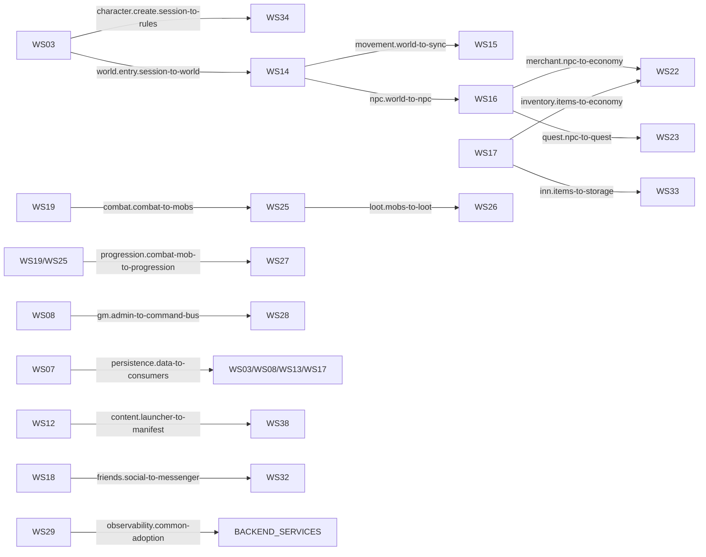

# WS39 Dependency Graph

Legend: `--X-->` breaking, `----->` non-breaking/pending.

- `WS03` --X--> `WS34` — `character.create.session-to-rules`
- `WS03` --X--> `WS14` — `world.entry.session-to-world`
- `WS14` --X--> `WS15` — `movement.world-to-sync`
- `WS14` --X--> `WS16` — `npc.world-to-npc`
- `WS16` --X--> `WS22` — `merchant.npc-to-economy`
- `WS16` --X--> `WS23` — `quest.npc-to-quest`
- `WS17` --X--> `WS22` — `inventory.items-to-economy`
- `WS17` -----> `WS33` — `inn.items-to-storage`
- `WS19` --X--> `WS25` — `combat.combat-to-mobs`
- `WS25` --X--> `WS26` — `loot.mobs-to-loot`
- `WS19/WS25` --X--> `WS27` — `progression.combat-mob-to-progression`
- `WS08` --X--> `WS28` — `gm.admin-to-command-bus`
- `WS07` --X--> `WS03/WS08/WS13/WS17` — `persistence.data-to-consumers`
- `WS12` --X--> `WS38` — `content.launcher-to-manifest`
- `WS18` --X--> `WS32` — `friends.social-to-messenger`
- `WS29` -----> `BACKEND_SERVICES` — `observability.common-adoption`

## Mermaid

