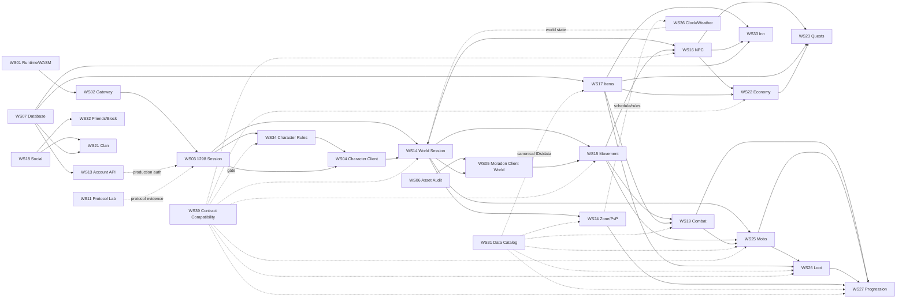
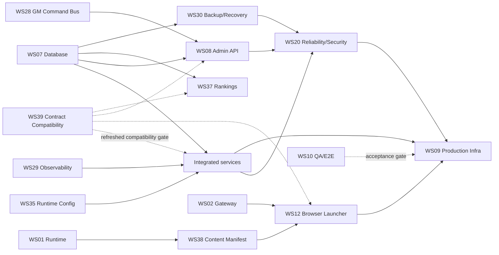

# WS40 Dependency Graph

This graph describes integration dependencies, not permission to merge. Dashed/conditional edges mean an adapter or composition step is required outside the producer workstream. The graph was refreshed after WS11, WS14, WS31, WS34 and WS39 closed during the audit.

## Primary release path

## Production/release path

## Evidence/validation dependencies

- **WS11 Protocol Lab is now COMPLETE/PASS.** It supplies source-pinned packet/framing/JvCryption evidence. Product/session contracts still need to consume that evidence; completion of the lab does not automatically clear cross-service packet contracts.
- **WS31 Data Catalog is now COMPLETE/PASS.** It contains 134 canonical records with zero canonical collisions and two HIGH legacy PID/SID alias findings. Downstream production adapters must consume canonical IDs and must not promote fixture/resource IDs to entity IDs.
- **WS39 Contract Compatibility is now COMPLETE/PASS as tooling.** Its captured report contains 14 breaking / 16 priority contracts. Its freshness note predates the late WS14/WS31/WS34/WS38 state, so a refreshed run/review against frozen integration SHAs is mandatory before release decisions.
- **WS10 QA** remains the end-to-end consumer of the assembled candidate and currently fails at the character-selectable milestone.

## Per-workstream dependency register

| WS | Depends on / consumes | Downstream consumers | Current dependency risk |
|---|---|---|---|
| WS01 | pinned OpenKO/assets/toolchain | WS02, WS12, WS38 | Browser lineage diverges from main. |
| WS02 | WS01 browser transport configuration | WS03, WS12 | Live WASM roundtrip still needs assembled proof. |
| WS03 | WS02, WS11; WS13/WS07 for production auth | WS04, WS14, WS34 | WS39 reports create/world handoffs breaking in captured snapshot. |
| WS04 | WS01 runtime, WS03 packets, WS34 rules | WS14/WS05 user flow | Latest CI FAIL. |
| WS05 | WS04/WS14, WS06 assets | WS15/RC4 | No WS-specific delivery evidence. |
| WS06 | browser/client asset sources | WS05, WS38/RC9 | No branch/delivery. |
| WS07 | PostgreSQL | WS08,13,14,17,21,22,30,33,37 | Missing STATUS; WS39 ISSUE-13 adapter conflicts; bounds reconciliation needed. |
| WS08 | WS07 persistence, WS28 commands | RC10/admin | WS39 ISSUE-12 live bridge missing; Inn mismatch. |
| WS09 | WS12/38 content, WS02 gateway, all service images, WS20/30 sign-off | RC9 | Scaffold until exact candidate/cutover proof exists. |
| WS10 | integrated candidate | all RC gates | No STATUS; latest E2E FAIL. |
| WS11 | pinned protocol/source evidence | WS03,14,21,39 | COMPLETE/PASS; adoption/contract refresh remains downstream work. |
| WS12 | WS01 package, WS02 gateway, WS38 manifest | RC9 | WS39 ISSUE-14: no manifest/hash consumption. |
| WS13 | WS07 repository | WS03/public account flows | WS39 ISSUE-13 repository-shape integration pending. |
| WS14 | WS03 validated selection, WS07 world repository | WS05,15,16,24,25,27,36 | Module green; WS39 audited before branch existed, so handoffs need refresh. |
| WS15 | WS14 world state, WS24 rules | WS16,19,25 | Live routing and refreshed WS14 contract check pending. |
| WS16 | WS14/15 world, verified NPC data | WS22,23,33 | WS39 ISSUE-05/06 merchant/quest contracts breaking. |
| WS17 | WS07, WS31 item data | WS19,22,23,26,33 | WS39 ISSUE-07 transaction port + Inn geometry unresolved. |
| WS18 | session/world presence | WS21,32 | WS39 ISSUE-15 private-message policy integration breaking. |
| WS19 | WS15 positions, WS17 equipment, WS31 data | WS25,27 | WS39 ISSUE-09 target-policy contract; exact tuning incomplete. |
| WS20 | integrated production candidate | WS09/RC10 | HIGH security finding + non-green workflow evidence. |
| WS21 | WS07, WS18, world presence, protocol evidence | clan consumers | Persistence/chat/packet binding pending. |
| WS22 | WS16 merchant, WS17 inventory, WS07 transaction | WS23 | WS39 ISSUE-05/07 breaking. |
| WS23 | WS16,17,22, persistence/progression | quest consumers | WS39 ISSUE-06 breaking. |
| WS24 | WS14/15 world/position data | WS27,36 | Composition pending. |
| WS25 | WS14/15/19, WS31 mob data | WS26,27 | WS39 ISSUE-10/11; synthetic fixture cannot ship. |
| WS26 | WS25 death, WS17 items, WS31 data | WS27 | WS39 ISSUE-10; authoritative drops still need production source. |
| WS27 | WS19/25/26/24, WS31 data | player progression | WS39 ISSUE-11 + authoritative XP/reward/respawn gaps. |
| WS28 | auth/command contracts, game adapters | WS08 | WS39 ISSUE-12 live bridge missing. |
| WS29 | service adoption | WS20/09/RC10 | Package green; WS39 ISSUE-16 confirms adoption gap. |
| WS30 | finalized WS07 schema/migrations | WS20/09/RC10 | Must rerun against release schema. |
| WS31 | source-backed 1298 catalog | WS17/19/24/25/26/27/39 | COMPLETE/PASS; two HIGH legacy PID/SID aliases and downstream fixture replacement remain. |
| WS32 | WS18 relation query, persistence | social runtime | Domain green; WS39 ISSUE-15 says consumer hook missing. |
| WS33 | WS07, WS17, WS16 | RC7 | WS39 ISSUE-08 compatible, but 196-slot model conflicts with WS08/DB bounds. |
| WS34 | WS03 create request, WS07, WS14, WS17 | RC3/WS14 handoff | COMPLETE/PASS; external packet/repository/spawn/item adapters pending. |
| WS35 | environment/secret consumers | all production services | Adoption is integration work. |
| WS36 | WS14/24/25 + optional WS28 control | world runtime | Module green; composition/persistence pending. |
| WS37 | WS07 read model | public website | Concrete SQL/read adapter pending. |
| WS38 | WS01 package/content, publisher | WS12/WS09 | COMPLETE/PASS; WS12 adoption still missing; WS39 captured pre-completion snapshot. |
| WS39 | all published interfaces/contracts | entire candidate | COMPLETE/PASS tooling; 14 breaking contracts and freshness refresh required. |

## Critical path to next gate

The shortest path from current **RC2** to **RC3** is:

`WS03<->WS34 adapter/response contract -> WS04 CI fix -> freeze SHAs -> refresh WS39 -> clear RC3 breaking contract -> WS10 M12 green`.

The shortest path from RC3 to RC4 is:

`WS06 asset audit -> WS05 real Moradon delivery -> WS03/WS14 selection-to-world composition -> refresh WS39 world contracts -> client zone load/spawn -> WS10 M13-M15 green`.
