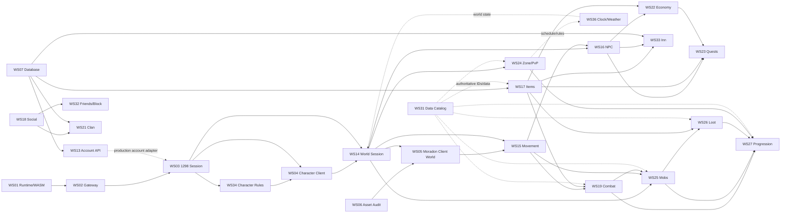
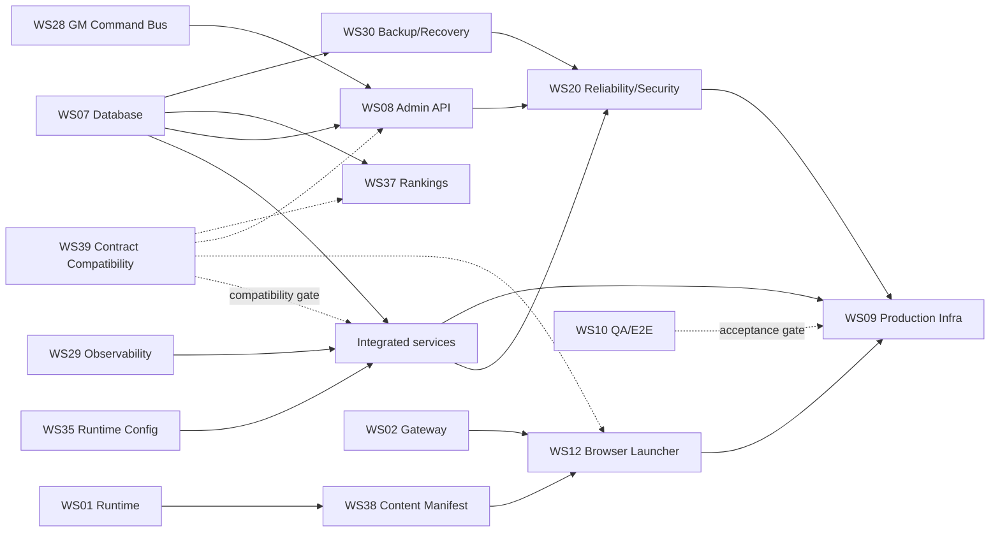

# WS40 Dependency Graph

This graph describes integration dependencies, not permission to merge. Dashed/conditional edges mean an adapter or composition step is required outside the producer workstream.

## Primary release path

## Production/release path

## Evidence/validation dependencies

- **WS11 Protocol Lab** is an evidence producer for packet/crypto ambiguities used by WS03/WS14/WS21 and should feed WS39 before unresolved packet shapes are accepted.
- **WS31 Data Catalog** is an evidence producer for authoritative 1298 IDs/tables/formulas. It must precede production activation of WS17/19/25/26/27 data adapters.
- **WS39 Contract Compatibility** is the cross-service registry/test gate. Its priority handoffs are WS12->WS38, WS18->WS32, WS17->WS33 and WS03->WS34, plus the WS03/04/14 character/world packet boundaries.
- **WS10 QA** is the end-to-end consumer of the integrated candidate. It should be merged/available as tooling before final assembly, but its gate runs occur after each integration wave.

## Per-workstream dependency register

| WS | Depends on / consumes | Downstream consumers | Current dependency risk |
|---|---|---|---|
| WS01 | pinned OpenKO/assets/toolchain | WS02, WS12, WS38 | Browser lineage diverges from main. |
| WS02 | WS01 browser transport configuration | WS03, WS12 | Live WASM roundtrip not yet proven. |
| WS03 | WS02 transport; WS13/WS07 for production auth | WS04, WS14, WS34 | Character/world orchestration incomplete in candidate. |
| WS04 | WS01 runtime, WS03 packets, WS34 create rules | WS14/WS05 user flow | Latest CI FAIL. |
| WS05 | WS04/WS14, WS06 assets | WS15/RC4 | No WS-specific delivery evidence. |
| WS06 | browser/client asset sources | WS05, WS38/RC9 | No branch/delivery. |
| WS07 | PostgreSQL | WS08,13,14,17,21,22,30,33,37 | Missing STATUS; schema/domain bounds need reconciliation. |
| WS08 | WS07 persistence, WS28 commands | RC10/admin | Inn contract conflict; execution bridge pending. |
| WS09 | WS12/38 content, WS02 gateway, all service images, WS20/30 sign-off | RC9 | Scaffold only until real candidate exists. |
| WS10 | integrated candidate | all RC gates | Latest E2E FAIL. |
| WS11 | protocol/source evidence | WS03,14,21,39 | No delivery evidence. |
| WS12 | WS01 package, WS02 gateway, WS38 manifest | RC9 | Manifest/CDN adoption pending. |
| WS13 | WS07 repository | WS03/public account flows | Adapter composition pending. |
| WS14 | WS03 validated selection, WS07 world repository | WS05,15,16,24,25,27,36 | Module green; composition pending. |
| WS15 | WS14 world state, WS24 rules | WS16,19,25 | Module green; live routing pending. |
| WS16 | WS14/15 world, verified NPC data | WS22,23,33 | Production NPC/Inn classification adapters pending. |
| WS17 | WS07, real item catalog | WS19,22,23,26,33 | Item data + Inn contract unresolved. |
| WS18 | session/world presence | WS21,32 | Social adapters pending. |
| WS19 | WS15 positions, WS17 equipment, WS31 skills/data | WS25,27 | Full authoritative skill/combat tuning incomplete. |
| WS20 | integrated production candidate | WS09/RC10 | HIGH security finding + failing workflow. |
| WS21 | WS07, WS18, world presence, protocol evidence | clan consumers | Persistence/chat/packet binding pending. |
| WS22 | WS16 merchant, WS17 inventory, WS07 transaction | WS23 | Production atomic adapter pending. |
| WS23 | WS16,17,22, persistence/progression | quest consumers | Script/data integration pending. |
| WS24 | WS14/15 world/position data | WS27,36 | Integration pending. |
| WS25 | WS14/15/19, WS31 mob data | WS26,27 | Synthetic fixture cannot ship. |
| WS26 | WS25 death, WS17 items, WS31 drops | WS27 | Authoritative drop dataset missing. |
| WS27 | WS19/25/26/24, WS31 XP/respawn | player progression | Authoritative progression data missing. |
| WS28 | auth/command contracts, game adapters | WS08 | Real execution adapters pending. |
| WS29 | service adoption | WS20/09/RC10 | Library not wired into product services. |
| WS30 | finalized WS07 schema/migrations | WS20/09/RC10 | Must rerun against release schema. |
| WS31 | authoritative 1298 sources | WS17/19/24/25/26/27/39 | Branch equals main; not delivered. |
| WS32 | WS18 relation query, persistence | social runtime | Domain green; wiring pending. |
| WS33 | WS07, WS17, WS16 | RC7 | 196-slot contract conflicts with WS08 and DB bounds. |
| WS34 | WS03 create request, WS04 client, WS07 persistence | RC3/WS14 handoff | No STATUS/test credit. |
| WS35 | environment/secret consumers | all production services | Adoption is integration work. |
| WS36 | WS14/24/25 + optional WS28 control | world runtime | Module green; composition/persistence pending. |
| WS37 | WS07 read model | public website | Concrete SQL/read adapter pending. |
| WS38 | WS01 package/content, publisher | WS12/WS09 | CDN/origin publication integration pending. |
| WS39 | all published interfaces/contracts | entire candidate | Branch equals main; registry/tests not delivered. |

## Critical path to next gate

The shortest path from current **RC2** to **RC3** is:

`WS34 completion evidence -> WS03/WS34 create contract -> WS04 CI fix -> WS03/04 create/select wiring -> WS39 contract tests -> WS10 M12 green`.

The shortest path from RC3 to RC4 is:

`WS06 asset audit -> WS05 real Moradon delivery -> WS03/14 selection-to-world composition -> client zone load/spawn -> WS10 M13-M15 green`.
