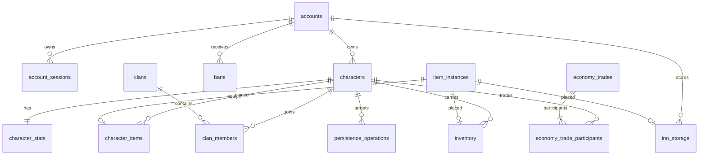

# WS07 schema contract

## Logical model

`session_leases`, `audit_log` and `server_state` are infrastructure tables with intentionally loose coupling to gameplay rows.

## Integrity rules

- `accounts.username_key` is globally unique and equals lowercase `username`; stored usernames must also be trimmed. Normalization beyond trim/lower remains the auth/domain owner's policy.
- Live characters are unique by `(account_id, slot)` and by case-normalized `name_key`. Deleted/tombstoned characters release those partial-unique keys through the lifecycle adapter.
- Item serials are globally unique in `item_instances`.
- One item instance can be placed in only one of equipment, inventory or inn storage. Cross-table duplicate placement is rejected by a trigger while the canonical item row is locked.
- WS17 persistence capacity is defended at the DB boundary: 14 equipment slots, 28 inventory slots, 196 inn slots. Inn's internal 28-slot page mapping is storage-only and is not a 1298 UI/protocol claim.
- A character's progression and world state have independent optimistic versions (`progression_version`, `world_version`); inventory uses character/account locks plus `item_version`/`inn_version` metadata.
- `economy_trade_participants` has a partial unique index that prevents more than one active trade for a character.
- `session_leases` has a primary key on `(scope, lease_key)` for WS45 compare-and-set semantics.
- `audit_log` is append-only.
- Hard account deletion is denied by default. Privileged maintenance must explicitly set `SET LOCAL oldko.allow_hard_delete='on'` inside a reviewed transaction.

## World state

Frequently queried authoritative fields stay typed (`zone_id`, position, level/EXP, HP/MP, base stats, coins). `characters.world_state` stores additional already-derived WS14/1298 snapshot fields whose formulas belong to other workstreams. WS07 does not calculate combat stats, item effects, XP curves or protocol business rules.

## Orphan prevention

Foreign keys protect accounts, characters, clans, placements, bans and trades. Character lifecycle deletion is soft by default and the WS46 adapter refuses final deletion while character-scoped inventory/equipment/clan membership remains, preventing cascade-based item orphaning. Account-scoped inn storage is never cleared by the character lifecycle adapter.
